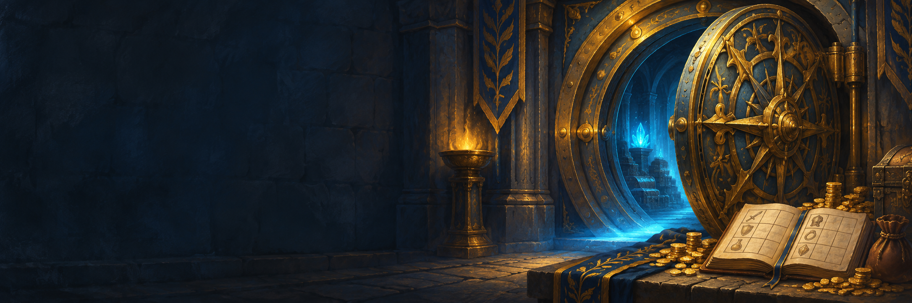

# Warband Vault Forever

[](https://github.com/Remgax/Warband-Vault-Forever/actions/workflows/build-release.yml)
[](https://github.com/Remgax/Warband-Vault-Forever/releases)



**Your characters. Their treasures. One vault.**

A character inventory browser for **World of Warcraft: Forever**, built for
Interface **16001**. Browse saved bags, character bank tabs, equipment, mailbox
attachments, and wallet gold without switching characters.

## Features

- Portrait roster with class colors, levels, realm names, gold, and name/gold sorting.
- Character-specific and all-character views with bags, bank, equipment, and mail tabs.
- Search by item name, ID, character, realm, or item type; filter by item quality.
- Item tooltips show recorded owners, quantities, location, and snapshot time.
- Native Shift-click item linking, virtualized item scrolling, movable window,
  automatic screen fitting, and adjustable UI scale.
- Original vault emblem and header artwork; no third-party addon dependencies.

## Install

1. Download **WarbandVaultForever-&lt;version&gt;.zip** from
   [Releases](https://github.com/Remgax/Warband-Vault-Forever/releases).
2. Extract `WarbandVaultForever` into `_forever_/Interface/AddOns/`.
3. Restart WoW after the first installation and enable **Warband Vault Forever**.
4. Type **`/wvf`** or click the vault icon near your minimap.
5. Log into each character once. Visit their bank and mailbox to record those locations.

The correct layout is
`_forever_/Interface/AddOns/WarbandVaultForever/WarbandVaultForever.toc`.
GitHub's generic source-code archive is not the installable release ZIP.

For local development on Windows:

```powershell
./tools/install.ps1 -WowPath 'D:\World of Warcraft\_forever_'
```

The installer backs up an existing addon folder before copying files. Account
SavedVariables are stored by WoW in its WTF folder and are not touched by it.

## Saved records and limitations

The addon can only record the character currently logged in. Recorded characters
remain browsable while offline; bank and mail records refresh when their owner
opens those locations. Saved times distinguish older records from current data.

Records belong to this local WoW account, across realms. They do not synchronize
other computers, other WoW accounts, or regions automatically. WoW writes them
to `WarbandVaultForever.lua` under the account's SavedVariables when you log out
or reload. Characters that have never loaded the addon cannot appear yet.

Your current character uses a live portrait. Offline portraits use race and gender,
since arbitrary rendered character appearances cannot be saved as a texture in
SavedVariables. Gold totals include wallets; mailbox gold is shown separately.
Mailbox records mark partial inboxes and retain expiration estimates.

This first alpha does not track shared account banks, guild banks, auctions,
currencies, or characters on other WoW accounts. The name "Warband Vault" refers
to the account inventory viewer, not an implementation of a shared bank system.

## Commands and key binding

| Command | Action |
| --- | --- |
| `/wvf` or `/warbandvault` | Open or close the vault |
| `/wvf scan` | Refresh accessible records |
| `/wvf minimap` | Toggle minimap shortcut |
| `/wvf resetui` | Reset position and scale |
| `/wvf help` | Show commands |

Assign **Open character vault** under **Warband Vault Forever** in WoW's key
binding settings. Press Escape to close the window.

## Development and releases

```powershell
python -m venv .venv
./.venv/Scripts/python.exe -m pip install -r requirements-dev.txt
./.venv/Scripts/python.exe tools/check.py
./.venv/Scripts/python.exe tools/package.py
```

The checks compile all runtime Lua with **Lua 5.1**, exercise model and scanner
regressions, verify TOC/XML/assets, and inspect deterministic release ZIPs.
See [manual game checks](docs/TESTING.md) for checks that require a running client.
Mocks validate addon behavior and do not prove Blizzard client rendering or API
availability. The initial target installation is build **1.60.1.70938**.

GitHub Actions validates pushes and pull requests and produces a downloadable ZIP
with a SHA-256 checksum. On main, a new TOC version is automatically tagged and
published after validation and packaging succeed. Existing releases are left
unchanged. Explicit `v*` tags are also supported and must exactly match the TOC version. Hyphenated versions
publish as prereleases; other versions publish as releases. Notes come from the
matching [changelog](CHANGELOG.md) entry.

For a new release, update the TOC version, `Vault.version` in `Core.lua`, and the
changelog, commit and push main. CI creates the matching annotated tag and release.
No personal token is required by the GitHub release workflow.

See [CurseForge listing text](docs/CURSEFORGE.md) and
[art provenance and prompts](docs/ART.md). Report bugs through
[GitHub Issues](https://github.com/Remgax/Warband-Vault-Forever/issues).

## License

[GNU GPLv3 (GPL-3.0-only)](LICENSE), copyright 2026 Remgax. Original generated artwork is included
under the same license. Blizzard game assets are referenced at runtime and are
not redistributed in this repository.
